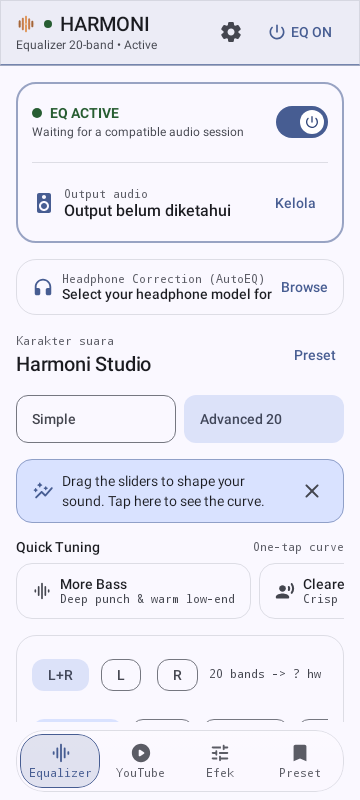
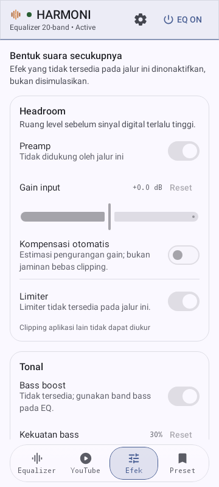
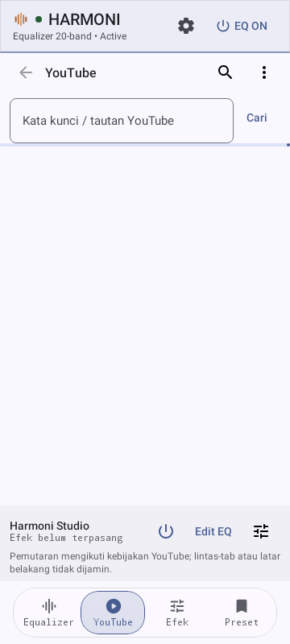

# Harmoni EQ — Studio Console

Konsol equalizer Android 20 band stereo (kanan/kiri terpisah) dengan kurva cubic Bezier real-time, koreksi headphone **AutoEQ**, preset snapshot lossless, undo/redo per gesture, A/B compare, ketahanan layanan latar belakang (Foreground Service + panduan OEM), profil output per perangkat Bluetooth, dan matriks kemampuan efek yang **jujur**: aplikasi tidak pernah mengklaim efek aktif kalau hardware/sesi audio tidak mendukungnya.

> **Disclosure — vibe coding:** aplikasi ini dibangun lewat *vibe coding*: pemilik proyek mengarahkan desain, palet, dan keputusan produk lewat percakapan, lalu AI agent menulis kode, tes, dan verifikasi di bawah arahan tersebut. Bukan kode tulis-tangan murni, dan bukan juga output AI yang diterima buta: setiap perubahan lewat tes unit/Robolectric (**76 tes**), kompilasi Gradle penuh, dan inspeksi visual hasil render UI.

## Unduh APK (Siap Pakai)

Pengguna dapat langsung mengunduh file APK terbaru tanpa perlu clone atau build secara manual:

- **[Unduh Harmoni EQ APK Terbaru (Direct Download)](https://github.com/rafifandriyanto/harmoni-eq/releases/latest/download/Harmoni-EQ-latest.apk)**
- **[Lihat Halaman GitHub Releases](https://github.com/rafifandriyanto/harmoni-eq/releases/latest)**

> **Catatan pemasangan:** File APK dibangun dan dipublikasikan secara otomatis oleh GitHub Actions (`.github/workflows/release-apk.yml`) setiap kali perubahan didorong ke branch `main`/`master` atau tag `v*`. Di perangkat Android, aktifkan izin *Install unknown apps* untuk browser/file manager saat memasang APK.

## Screenshot

Render Compose NATIVE (Robolectric) terbaru dengan logo vektor Warm Amber, Top Bar ringkas, Master EQ Hero Deck, kartu AutoEQ, Quick Tuning, dan UI Restrained Glass (Dark & Light support, custom accent):

| Equalizer (Advanced) | Simple | Efek |
| --- | --- | --- |
|  |  |  |

| Preset | YouTube terintegrasi | Tablet 1024 dp |
| --- | --- | --- |
|  |  |  |

## Pembaruan & Perbaikan Terbaru (Fase 1–6)

Berikut ringkasan seluruh perbaikan dan fitur baru yang telah ditambahkan:

### 1. Kurva EQ Real-Time, Onboarding Terarah & Top Bar Ringkas
- **Overlay Kurva Cubic Bezier Real-Time (`EqCurveOverlay.kt`, `FrequencyCurveCanvas.kt`)**: Garis kurva Catmull-Rom halus melintasi 20 fader dengan pembaruan langsung saat menggeser slider atau menerapkan preset/AutoEQ.
- **Transisi Terarah Simple → Advanced**: Tombol *"Fine-tune this sound"* dari mode Simple langsung membuka mode Advanced 20-band dan menggulir ke rentang frekuensi yang sesuai, dilengkapi 7 chip lompat frekuensi (*Sub-Bass* s.d. *Air*), 4 preset *Quick Tuning*, dan tip onboarding singkat.
- **Visibilitas Status & Top Bar Lega**: Top Bar disederhanakan agar judul `HARMONI` selalu lega tanpa terpotong (termasuk pada skala font 200% di lebar 360dp), hanya menyisakan **Pengaturan** dan **`EQ ON / BYPASS`** serta indikator aktif persisten. Tombol *AutoEQ*, *Reset to Flat*, dan *Bantuan* ditempatkan sesuai konteks di layar Equalizer dan lembar Pengaturan.

### 2. AutoEQ Headphone Correction & Sinkronisasi Master Switch
- **Katalog `jaakkopasanen/AutoEq` & Interpolasi 20-Band**: Mengambil katalog headphone dari jsDelivr CDN dengan fallback otomatis ke GitHub Git Trees API & `raw.githubusercontent.com` (semua I/O jaringan di `Dispatchers.IO` dengan validasi host HTTPS dan batas ukuran respons). `AutoEqCsvParser` mem-parsing data pengukuran CSV dan `AutoEqInterpolator` memetakannya ke 20 frekuensi tengah ISO (`25 Hz – 18 kHz`) pada skala logaritmik menggunakan monotone cubic Hermite spline (PCHIP).
- **Pencarian Cepat, Cache Offline & Error Handling**: Pencarian in-memory (case-insensitive) dengan debounce `300ms`, penyimpanan offline via DataStore (`harmoni_autoeq_prefs_v1`) untuk indeks, CSV, profil aktif, dan backup kurva manual, serta tampilan error *Glassmorphism* dengan tombol **Retry** dan fallback otomatis ke cache saat offline.
- **Mesin Status Master Switch (States A/B/C/D)**: Tombol Master EQ selalu sinkron dengan status AutoEQ — menampilkan badge **`AutoEQ: Active`** di Top Bar, meredupkan fader & kurva saat bypass tanpa menghapus profil terpilih, dan otomatis melepas status AutoEQ jika pengguna menggeser fader manual.

### 3. Ketahanan Latar Belakang & Panduan Izin OEM
- **Foreground Service Persisten (`AudioForegroundService.kt`)**: Menjaga engine DSP tetap hidup di latar belakang dengan channel notifikasi prioritas rendah (`IMPORTANCE_LOW`), status *"Harmoni EQ is running"*, serta aksi **Pause/Stop** langsung dari notifikasi.
- **Reliability Hub & Battery Optimization Exemption**: Deteksi status `PowerManager.isIgnoringBatteryOptimizations`, permintaan pengecualian baterai, izin notifikasi Android 13+, dan panduan langkah khusus OEM (Xiaomi/MIUI, Samsung, Oppo/Realme, Vivo, Huawei) agar proses tidak dimatikan sistem.

### 4. Optimasi Performa 120Hz (Fase 5)
- **Fader Phase Skipping (`ProEqFader.kt`)**: Pembacaan nilai gain `Float` kontinu selama drag vertikal dipindahkan ke **Draw phase** via `Modifier.drawWithCache { ... onDrawBehind { ... } }` sehingga fase Composition & Layout dilewati saat drag. Label angka dB diisolasi ke leaf composable `FaderValueReadout` berbasis `derivedStateOf`, dan `Modifier.graphicsLayer` dibatasi hanya pada lapisan opacity terarah.
- **Zero-Allocation Bezier Curves (`EqCurveOverlay.kt`, `FrequencyCurveCanvas.kt`)**: Menggunakan `Modifier.drawWithCache` dengan objek `Path`, `FloatArray`, `Stroke`, dan `Brush.verticalGradient` pra-alokasi, snapshot gain berbasis `derivedStateOf`, serta `Path.rewind()` di dalam draw loop agar bebas alokasi memori per frame.
- **Dynamic Glass Blur Radius (`GlassSurface.kt`, `HarmoniEqApp.kt`)**: Pada Android 12+ (API 31+), `RenderEffect.createBlurEffect` diterapkan pada lapisan backdrop kaca terpisah (`matchParentSize()`) di belakang konten tajam dan di-memoize via `remember(quantizedBlurPx)`. Radius blur turun mulus dari `20.dp` (idle) ke `8.dp` saat drag/scroll aktif, dengan fallback near-solid bersih pada API < 31 dan mode *Reduce Transparency*.
- **Stabilitas Daftar & Pemisahan Thread Audio (`EqualizerScreen.kt`, `StudioAudioEngine.kt`)**: Menambahkan `key` + `contentType` eksplisit pada seluruh `LazyRow` serta `rememberUpdatedState` pada `LaunchedEffect`. Interpolasi gain halus 100ms di `StudioAudioEngine` berjalan di luar Main Thread (`Dispatchers.Default`) dengan sinkronisasi `Mutex` dan preemption `AtomicLong`.

### 5. Identitas Visual (Logo) & Seamless Splash Screen (Fase 6)
- **Logo Minimalis & Adaptive Icon**: Logo vektor 5-bar studio equalizer bernuansa Warm Studio Amber (`#E09A60` / `#C77D4A`) di atas Obsidian Charcoal (`#0E1013`) tanpa gradien generik (`ic_logo.xml`, `ic_splash_logo.xml`, `ic_launcher_background.xml`, `ic_launcher_foreground.xml`), lengkap dengan fallback PNG raster `mdpi`–`xxxhdpi` dan ikon inline pada `GlassTopBar`.
- **Seamless Splash Screen (AndroidX SplashScreen API)**: Menggunakan `androidx.core:core-splashscreen:1.0.1`, tema `Theme.App.Starting` (`#0E1013`), `setKeepOnScreenCondition { !eqViewModel.uiState.value.libraryRestored }` (tanpa timer buatan), dan animasi keluar fade + subtle scale langsung ke kanvas gelap aplikasi.

## Fitur Utama Lainnya

- **UI Restrained Glass Modern:** Permukaan kaca berlapis dengan tema Dark & Light adaptif, kustomisasi aksen (Amber, Sage, custom hex), serta toggle **Reduce Transparency** & **Reduce Motion** (`harmoni_theme_prefs_v1`). Detail token desain ada di [README-DESIGN-SYSTEM.md](README-DESIGN-SYSTEM.md).
- **EQ 20-Band Stereo Penuh:** Mode Simple (Bass/Mid/Treble) dan Advanced (fader per band, fokus kanal L/R/linked, kurva EQ interaktif).
- **Preset `SoundSnapshot` v2 Lossless:** Menyimpan EQ + efek + headroom, impor/ekspor JSON lewat SAF, batas 200 preset kustom dengan pemangkasan transparan.
- **Alat Studio:** Undo/redo per gesture, A/B slot penuh, salin L→R, haluskan kurva, reset EQ terpisah dari reset efek.
- **Matriks Kemampuan Efek Jujur:** `DynamicsProcessing` (API 28+) dengan fallback `Equalizer` hardware, estimasi headroom, serta meter VU/scope **hanya** untuk sinyal audio uji internal.
- **Output Bluetooth:** Deteksi rute terhubung vs aktif, profil preset per perangkat, auto-profile opt-in tanpa pernah mengubah volume/pairing sistem.
- **YouTube WebView Dikeraskan:** Navigasi tepercaya, mixed content ditolak, file access nonaktif, lifecycle mengikuti Activity.

## Yang TIDAK dijanjikan

- Tidak ada klaim "EQ universal semua aplikasi": efek pada pemutar lain bergantung pada sesi pemutar, versi Android, dan perangkat. Status di aplikasi mengatakan apa adanya.
- Meter tidak mengukur audio aplikasi lain; hanya audio uji internal.
- Verifikasi otomatis berjalan pada JVM/Robolectric + render native + APK debug ter-sign; perilaku offload Bluetooth di tiap perangkat fisik tetap bergantung pada firmware OEM.

## Status Verifikasi

- **76/76 unit & Robolectric test lolos** (termasuk alur klik ujung-ke-ujung pada `MainActivity` + SplashScreen, uji drag/tap fader Phase Skipping, uji AutoEQ & Master Switch state machine, uji font 200%, serta render UI).
- Kompilasi `:app:assembleDebug` sukses dengan konfigurasi `signingConfigs`, `applicationId`, dan `namespace` tetap terjaga.

## Build & Tes Lokal

Prasyarat: JDK 17+, Android SDK (`compileSdk 36`), `keytool` di PATH.

1. Pulihkan (atau buat) keystore debug standar (`debug.keystore` di-ignore git):

   ```bash
   base64 -d debug.keystore.base64 > debug.keystore
   ```

   Atau buat keystore debug baru jika file base64 tidak tersedia:

   ```bash
   keytool -genkeypair -v -keystore debug.keystore -storepass android -alias androiddebugkey \
     -keypass android -keyalg RSA -keysize 2048 -validity 10000 -dname "CN=Android Debug,O=Android,C=US"
   ```

2. Jalankan tes & build APK:

   ```bash
   ./gradlew :app:testDebugUnitTest :app:assembleDebug
   ```

   APK keluar di `app/build/outputs/apk/debug/app-debug.apk`. Render UI tes ditulis ke `app/build/ui-preview/`.

Tidak perlu API key apa pun: `.env.example` hanyalah sisa template ekspor; kode aplikasi tidak memanggil layanan AI berbayar.

## Struktur Singkat

- `app/src/main/java/com/example/audio/` — engine DSP (`StudioAudioEngine` dengan `DynamicsProcessing` + fallback), monitor output, Foreground Service, Quick Settings Tile.
- `app/src/main/java/com/example/data/` — codec preset v2, repository DataStore, sumber data & parser AutoEQ (`AutoEqRepository`, `AutoEqCsvParser`, `AutoEqInterpolator`).
- `app/src/main/java/com/example/ui/` — `EqualizerViewModel`, `AutoEqViewModel`, layar & komponen Jetpack Compose (`ProEqFader`, `EqCurveOverlay`, `FrequencyCurveCanvas`, `GlassSurface`, `AutoEqBottomSheet`, `ReliabilityScreen`).
- `app/src/test/` — 76 tes JVM/Robolectric (gate ViewModel, logika AutoEQ, kebijakan engine, regresi sound, UX refinement, UI klik nyata, render).
- `.github/workflows/release-apk.yml` — workflow CI/CD GitHub Actions otomatis untuk menjalankan tes, build APK, dan merilis `Harmoni-EQ-latest.apk` ke GitHub Releases.
- `docs/screenshots/` — render UI terbaru yang ditampilkan pada README ini.