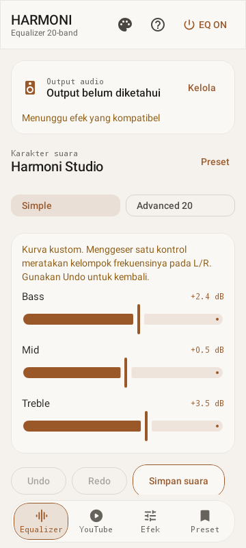
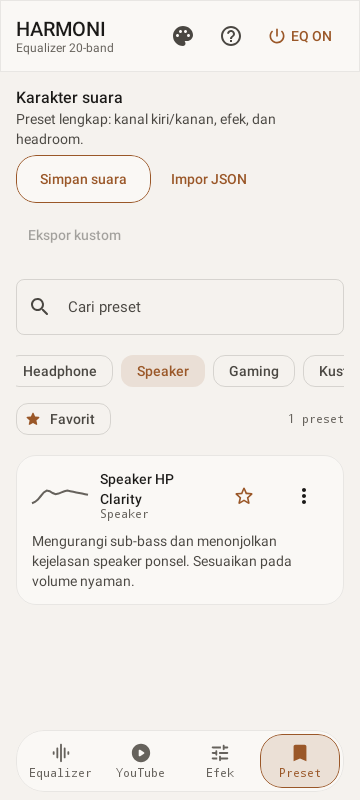
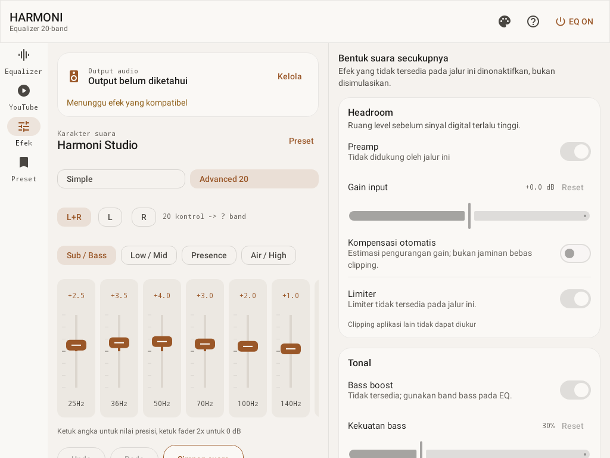

# Harmoni EQ — Studio Console

Konsol equalizer Android 20 band stereo (kanan/kiri terpisah) dengan preset snapshot lossless, undo/redo per gesture, A/B compare, profil output per perangkat Bluetooth, dan matriks kemampuan efek yang **jujur**: aplikasi tidak pernah mengklaim efek aktif kalau hardware/sesi audio tidak mendukungnya.

> **Disclosure — vibe coding:** aplikasi ini dibangun lewat *vibe coding*: pemilik proyek mengarahkan desain, palet, dan keputusan produk lewat percakapan, lalu AI agent (Qoder) menulis kode, tes, dan verifikasi di bawah arahan tersebut. Bukan kode tulis-tangan murni, dan bukan juga output AI yang diterima buta: setiap perubahan lewat tes unit/Robolectric (49 tes), lint, render UI yang diperiksa visual, dan satu putaran review kode independen yang temuannya ditutup atau ditolak dengan bukti. Riwayat keputusan ada di dokumen PRD terpisah (tidak ikut repo ini).

## Unduh APK (Siap Pakai)

Pengguna dapat langsung mengunduh file APK terbaru melalui halaman GitHub Releases tanpa perlu clone atau build secara manual:
- [Unduh Harmoni EQ APK Terbaru](https://github.com/rafifandriyanto/harmoni-eq/releases/latest)

## Screenshot

Render Compose NATIVE (Robolectric, bukan emulator) dari kode repo ini dengan UI Restrained Glass baru (Dark & Light support, custom accent):

| Equalizer (Advanced) | Simple | Efek |
| --- | --- | --- |
|  |  |  |

| Preset | YouTube terintegrasi | Tablet 1024 dp |
| --- | --- | --- |
|  |  |  |

## Fitur

- **UI Restrained Glass Modern:** UI chrome translucent dengan `RenderEffect` blur (API 31+), fallback translucent halus (API < 31), tema Dark & Light adaptif, kustomisasi warna aksen (Amber, Sage, custom hex), serta toggle **Reduce Transparency** & **Reduce Motion** (tersimpan di DataStore `harmoni_theme_prefs_v1`). Dokumentasi token desain lengkap ada di [README-DESIGN-SYSTEM.md](README-DESIGN-SYSTEM.md).
- **Optimasi Performa 60fps:** Selama drag fader atau scroll daftar, efek blur dimatikan sementara (`LocalGlassBlurSuppressed`) dan backdrop spot di-pre-render statis (`StaticRadialBackdrop.kt`) untuk menjaga framerate 60fps stabil.
- EQ 20 band stereo: mode Simple (Bass/Mid/Treble) dan Advanced (fader per band, fokus kanal L/R/linked, kurva EQ yang bisa diseret).
- Preset `SoundSnapshot` v2 lossless (EQ + efek + headroom), impor/ekspor JSON lewat SAF, batas 200 preset kustom dengan pemangkasan yang jujur dan banner persisten.
- Undo/redo per gesture, A/B slot penuh, salin L→R, haluskan kurva, reset EQ terpisah dari reset efek.
- Matriks kemampuan efek per jalur audio (DynamicsProcessing API 28+ dengan fallback Equalizer hardware), estimasi headroom, meter VU/scope **hanya** dari sinyal audio uji internal — tidak ada spektrum palsu.
- Output Bluetooth: deteksi rute terhubung vs terpakai, profil preset per perangkat, auto-profile opt-in; tidak mengubah volume/rute/pairing sistem.
- Layanan foreground jujur (`START_NOT_STICKY`): notifikasi mengatakan apa yang sebenarnya diproses.
- YouTube WebView yang dikeraskan (navigasi tepercaya, mixed content ditolak, file access mati, lifecycle mengikuti Activity).
- Persistensi DataStore tahan upgrade + flush saat ViewModel cleared; draft nama/impor tahan process death.

## Yang TIDAK dijanjikan

- Tidak ada klaim "EQ universal semua aplikasi": efek pada pemutar lain bergantung pada sesi pemutar, versi Android, dan perangkat. Status di aplikasi mengatakan apa adanya.
- Meter tidak mengukur audio aplikasi lain; hanya audio uji internal.
- Belum ada bukti uji perangkat fisik/Bluetooth publik; verifikasi saat ini = JVM/Robolectric + render + APK ter-sign debug.

## Status verifikasi

- 49/49 unit test lolos (termasuk alur klik ujung-ke-ujung pada `MainActivity` asli), lint 0 error.
- `:app:assembleDebug` sukses; APK diverifikasi `apksigner` (signer debug standar).
- `signingConfigs`, `applicationId`, dan `namespace` dipertahankan apa adanya dari ekspor asli.

## Build & tes

Prasyarat: JDK 17+ (JBR Android Studio cukup), Android SDK (compileSdk 36), `keytool` di PATH atau dari JBR.

1. Buat keystore debug standar (file ini di-ignore git, jadi clone baru perlu membuatnya):

   ```bash
   keytool -genkeypair -v -keystore debug.keystore -storepass android -alias androiddebugkey \
     -keypass android -keyalg RSA -keysize 2048 -validity 10000 -dname "CN=Android Debug,O=Android,C=US"
   ```

2. Tes + lint + APK:

   ```bash
   ./gradlew :app:testDebugUnitTest :app:lintDebug :app:assembleDebug
   ```

   APK keluar di `app/build/outputs/apk/debug/app-debug.apk`. Render UI tes ditulis ke `app/build/ui-preview/`.

Tidak perlu API key apa pun: `.env.example` hanyalah sisa template ekspor AI Studio; kode aplikasi tidak memanggil Gemini.

## Struktur singkat

- `app/src/main/java/com/example/audio/` — engine DSP (DynamicsProcessing + fallback), monitor output, layanan foreground.
- `app/src/main/java/com/example/ui/` — ViewModel, kebijakan (auto-profile, headroom, merge pustaka), layar & komponen Compose.
- `app/src/main/java/com/example/data/` — codec preset v2 + repository DataStore.
- `app/src/test/` — 49 tes JVM/Robolectric (gate ViewModel, kebijakan engine, regresi sound, UI klik nyata, render).
- `docs/screenshots/` — render UI yang dipakai README ini.